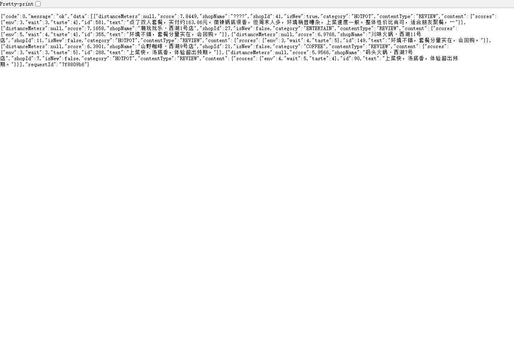

# 本地生活双端 Agent 平台（代号 ScoutBite 探店雷达）

本地生活双端 Agent MVP：用户被 Agent 推荐到店并完成评价，商家被 Agent 分析并行动。

## 演示入口（2026-10-11 完善版）

**先运行独立演示，无需 Docker、数据库或模型密钥：**

```powershell
powershell -ExecutionPolicy Bypass -File deploy\start-demo.ps1
# 默认 http://127.0.0.1:5173/#/discover
# 端口被其他应用占用时：追加 -Port 5174
# 需要自动打开浏览器时：追加 -OpenBrowser
```

也可在 `apps/web` 执行 `npm ci`、`npm run dev`。首次进入是本地演示用户；侧栏可直接切商家端，登录页可切管理员。顶部常驻数据模式标识，`/#/demo` 提供操作导览与示例重置。

- 用户端：搜索分类与排序、附近坐标示意、探店笔记、店铺详情、领券与选券结算、订单支付/核销/退款、可编辑且需确认的评价草稿、可点开的推荐评论证据。
- 商家端：经营指标、订单核销、套餐创建/编辑/上下架、券创建与领取统计、评价回复、经营/评论/竞品三类分析、门店入驻与审核进度。
- 管理员：待审/通过/驳回队列，审核改变用户侧可见性。未审核店不能直接查看套餐或下单。

**两种模式有明确边界：**本地演示数据保存在当前浏览器，Agent 是标注为示例的确定性输出；它展示交互与状态规则，不能证明模型效果、SQL/Redis 并发或真实支付。顶部主动切换「真实服务」后，请重新登录；所有请求走 Java 主站，不会在请求失败时偷偷切换成示例成功。店铺图片是本地展示素材，不是对应门店实拍，来源见 `apps/web/public/images/CREDITS.md`。

完整操作稿见 [docs/demo-script.md](docs/demo-script.md)，本轮补齐项、测试与真实联调限制见 [docs/demo-readiness.md](docs/demo-readiness.md)。

## 架构一句话

**Agent 不直连数据库**：它只能通过 shop-api 的 `/internal` 只读接口拿「瘦事实」，写操作永远走用户 JWT。

```
Vue3(web) ──用户JWT──▶ shop-api(Spring Boot :8081) ──转发──▶ agent-api(FastAPI :8000)
                          ▲   │                                │
                     PG/Redis/MinIO ◀──JDBC──┘   （起回头调 /internal 拿瘦事实）
```

## 快速开始

```powershell
# 真实服务：自动选本项目 Native 基础设施或 Docker
# 需要 Node.js LTS、Java 21、Maven、Python 3.11+
powershell -ExecutionPolicy Bypass -File deploy\start-all.ps1

# 当前机器已验证 Native PG18 / Redis，本项目数据与原有服务隔离
powershell -ExecutionPolicy Bypass -File deploy\start-all.ps1 -Infrastructure Native
python deploy\prepare-demo.py
# 真店铺：潮牛火锅·西湖1号店；演示套餐198元、满100减20、未评价核销单

# 验收
#   http://localhost:8081/swagger-ui.html   ← 主站 Swagger（9 个分组）
#   http://localhost:8081/actuator/health   ← {"status":"UP"}
#   http://localhost:8000/docs              ← Agent 文档站
```

`start-all.ps1` 在源文件比 jar 新时构建并测试 Java，以隐藏进程启动缺失服务，日志在 `deploy/logs`。`Auto` 优先复用已有的项目隔离 Native 数据目录，否则检测 Docker。可用 `-PostgresBin`、`-RedisServer` 指定原生工具路径，或显式 `-Infrastructure Docker`。

Native 的真实 PG/Redis 数据保存在忽略入库的 `deploy/runtime`，使用 5433/6380，与本机其他服务隔离；启动前校验实际端口 PID 和数据目录。Web/Java/Python 复用也核对工作区、profile 和版本，旧版本会要求先停止旧项目进程再启动，避免误用其他服务。演示 profile 的支付窗口为15分钟；默认业务配置仍为30秒，用于独立超时对账。

Agent 配置保留在忽略入库的 `services/agent-api/.env`；真实模型请求需要有效密钥。Java 启动时先运行原建表脚本，再执行 `db/updates/20261010-shop-address.sql` 的幂等增量更新，无需删除已有数据库。

## 种子账号（DataSeeder 自动写入，密码以 seeder 为准）

| 手机号 | 密码 | 角色 | 说明 |
|---|---|---|---|
| 13900000000 | admin123456 | ADMIN | 管理员（不开放注册） |
| 13611110001 | user123456 | USER | 辣妹小队长（吃辣党画像） |
| 13611110002 | user123456 | USER | 奶爸阿伦（亲子党画像） |
| 13611110003 | user123456 | USER | 咖啡因选手（咖啡党画像） |
| 13611110004 | merchant123456 | MERCHANT | 演示店长；真实 Seeder 只绑定仍无主的指定种子店 |

真实种子账号与演示浏览器账号是两份隔离数据。商家 Seeder 已实际验证；只绑定指定且仍无主的种子店，不覆盖真实所有者。参考人均只属于示例资料，真实店卡显示实际评价评分和套餐起价；历史种子评论标记为展示样本，真实新评价绑定实际核销订单。

## 本轮验证

```powershell
# 前端状态、模式隔离和浏览器流程
cd apps/web
npm test
npm run build
npm run test:e2e
# 没有本地 Chromium 时：npx playwright install chromium

# Java（在 services/shop-api）
mvn -B -ntp -s maven-settings.xml package

# Python（在 services/agent-api；不调用模型）
.venv\Scripts\python.exe -m unittest discover -p 'test_*.py' -v

# 真实浏览器流程（apps/web；会请求已配置的模型）
$env:SCOUTBITE_LIVE_TESTS='1'
npx playwright test tests/e2e/live.spec.js
```

本轮通过前端逻辑15项、独立浏览器12条、真实浏览器2条、Java74项、Agent Python42项、评测CLI27项、验收工具27项；前端构建及桌面/390px手机/1024px小桌面检查通过。真实 PostgreSQL/Redis/Java/Python/DeepSeek 全链路验收13/13，并发/超时对账6/6。证据见 [真实验收](docs/reports/real-integration-final-pass-20261011.json) 与 [并发对账](docs/reports/concurrency-20261010.json)。

当前 Docker Desktop 自身 IPC 问题仍在，但项目已用隔离 Native 路径完成真实验证；不依赖恢复 Docker 才能演示。Redis 实测版本为 Windows 3.0.504，PG为18.4，不能把本地数字说成生产吞吐或 Docker Redis7 的测试。

## 当前真实 Agent 评测

报告：[full-20261011-release.md](evals/reports/full-20261011-release.md)。DeepSeek chat，65/65用例通过：推荐30、评价20、商家15；评价生成后新增评价为0。p50分别2332ms / 604ms / 1507ms，92次调用成本粗估¥0.5046。

评价模型现在只选择经过过滤的用户体验ID与评分，程序绑定真实订单套餐/金额；商家观察只选择原始数据事实ID，模型生成假设与建议；推荐先扩大有供给候选并参考套餐起价筛选预算。护栏失败和服务错误仍明确失败，不能冒充成功。

商家15例映射1家真实门店，预算指标是套餐起价参考，评分/Judge有样本与同族偏差。此报告是当前固定数据集结果，不保证线上零幻觉；第一轮58/65及后续失败报告全部保留。`evals/run_eval.py --check --fixtures ...` 免费检查事实，运行full需显式fixtures与密码环境变量，默认新报告不会覆盖历史或创建消费订单。

当前券并发验证使用每轮新券、独立用户与新套餐；200人抢100券恰好100成功，Redis余量0、DB新增100行；同人20并发仅1次成功；库存1仅一单；实际5秒到期后库存/券/订单状态全部归位。

```powershell
# 项目根目录；PGPASSWORD只通过进程环境提供，不写报告
python deploy/verify_real.py --db-mode native --psql E:/PSG/bin/psql.exe --redis-port 6380
# 并发脚本另需临时8082业务实例 --scoutbite.order.expire-seconds=5，详情见验收记录
python deploy/verify_concurrency.py --psql E:/PSG/bin/psql.exe --timeout-shop-url http://127.0.0.1:8082
```

## 历史压测与对账（保留原证据）

**压测** `python deploy/loadtest_claims.py`：200 并发抢 100 张券（券3·店1，per_user_limit=1）

- ① 不超卖：成功 = 100 ≤ 100，100 人被 40902/40901 业务性拒绝
- ② Redis 余量 = 0 == 100 − 100
- ③ DB user_coupons 新增 100 行 == 成功数（13900000100~205 段独立用户）
- ④ 同人 20 并发双击只成功 1 次（幂等）

**关单对账** `python deploy/close_order_check.py`（等真实超时 35s，非造数）：

- 用例A（无券）：订单 75 → CANCELLED_TIMEOUT，SKU5 库存回补
- 用例B（用券）：订单 76 → CANCELLED_TIMEOUT，SKU6 库存回补 + 券5 FROZEN→UNUSED
- 三源独立对账：订单表 / SKU 表 / 券表 互相印证

## 历史离线评测

历史报告 [evals/reports/latest.md](evals/reports/latest.md) 保留。当前脚本需显式fixtures，使用 `--mode full --fixtures ... --report ...`；`--full`兼容别名也不会绕过数据预检。

| 技能 | 用例 | 通过率 | p50 | 硬约束指标 |
|---|---|---|---|---|
| recommend | 30 | 100% | 3361ms | 品类/预算/引用存在率全过 |
| review-draft | 20 | 90% | 1322ms | 2 例 no_fabrication 诚实记录为失败 |
| merchant | 15 | 100% | 2512ms | 观察/假设/建议三层 + 无确定性断言 |

LLM 成本：107 次调用 ≈ ¥0.6184。失败用例与评测边界见报告第 5 节。

## 探索开关同屏对比（explore=true|false）

新店（7 日内过审）×2 探索加成。同一请求只切开关：新店(shopId 41) score 从 **15.69 → 7.84**，其余店不变。

| explore=true | explore=false |
|---|---|
|  |  |

> 本轮种子数据中新店内容质量恰好也高，关掉开关排名未掉出前 3——score 数值差异是开关生效的直接证据。

## 目录

| 路径 | 说明 |
|---|---|
| services/shop-api | Spring Boot 3 · Java 21 · 业务与鉴权 :8081 |
| services/agent-api | FastAPI + LangGraph · Agent 大脑 :8000 |
| apps/web | Vue 3 前端 :5173 |
| deploy | docker-compose（PG / Redis / MinIO）+ 压测/对账脚本 |
| docs | PRD / ADR / ER / 演示稿 / [known-issues](docs/known-issues.md) |
| evals | Agent 评测数据集与报告 |
| 学习指南 | 十日工坊学习站点（离线 HTML） |

## 端口清单（本机环境导致的偏移，见 docs/decisions.md ADR-015/019）

| 端口 | 服务 | 备注 |
|---|---|---|
| 8081 | shop-api | Swagger: /swagger-ui.html；原计划 8080 被 aio-sandbox-mcp 容器占用 |
| 8000 | agent-api | 文档: /docs |
| 5173 | web (Vite) | 起 |
| 5433 | postgres (容器) | 宿主 5433 → 容器 5432，**避本机已装的 PG** |
| 6380 | redis (容器) | 宿主 6380 → 容器 6379，**避本机已装的 Redis** |
| 9000/9001 | minio | S3 API / 控制台（scoutbite / scoutbite123） |

## 统一返回与错误码

```json
{ "code": 0, "message": "ok", "data": {}, "requestId": "a1b2c3d4" }
```

| code | 含义 |
|---|---|
| 0 | 成功 |
| 40001 | 参数/约束错误 |
| 40100 | 未登录 |
| 40300 | 角色不对 |
| 40901 | 幂等冲突或重复评价 |
| 40902 | 库存或券不足 |
| 40903 | 状态机冲突 |
| 42201 | Agent 护栏拦截 |

## 已知问题（诚实清单）

演示项目的已知局限与升级路径见 [docs/known-issues.md](docs/known-issues.md)——包括 2 例菜品级编造抓拍、评论聚类为关键词分桶、草稿仓内存化等 8 项。

详见 `docs/` 与 `docs/api.http`（VS Code REST Client 可直接执行联调用例）。
